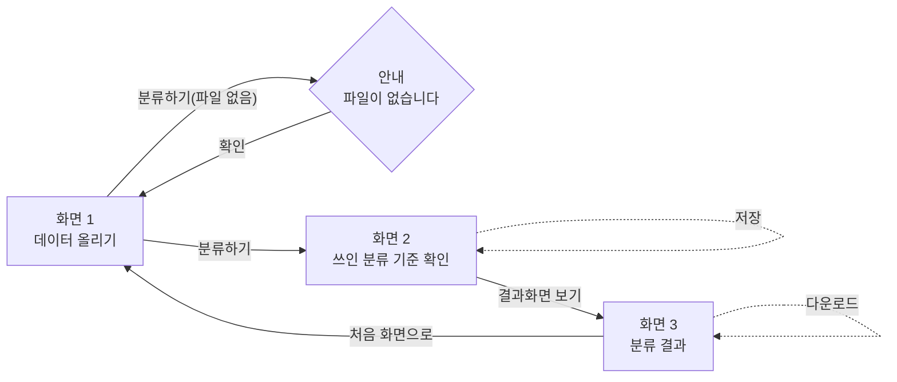

# PRD — 데이터 올리기
- 상태 : 초안
- 한 줄 정의 : 데이터를 가지고 콘텐츠를 만드는 사람이, 데이터를 넣으면 메타데이터(생애주기·분야·정보유형 등)분류하여, 가공이 가능한 데이터로 형태로 만들어준다.

## 1. 문제

### 배경
- 지금은 데이터 내용을 아는 사람이 하나하나 내용을 확인하고 분류를 직접 등록해야 한다. (근거: user.md "지금은 어떻게")
- 그 방식이 불편해서 이 서비스가 필요하다. (근거: user.md "왜")
- 이 문제는 과거·앞으로 등록된 데이터를 생애주기·분야·정보유형별로 나눠서 콘텐츠화하려고 할 때 발생한다. (근거: user.md "언제")

### 목표
- 표·글 파일을 넣으면 생애주기·분야·정보유형 기준으로 자동 분류하여, 콘텐츠 제작에 바로 쓸 수 있는 가공된 데이터 형태로 만들어 준다. (근거: topic.md 한 줄 정의, ipo.md 처리/출력)
- 처리 시간 목표는 따로 두지 않는다. 분류 정확도는 90% 이상을 목표로 한다.

## 2. 사용자

### 페르소나
- 누구 : 과거와 앞으로 등록되는 데이터를 가지고 콘텐츠를 만들 사람 (근거: user.md "누구인가")
- 상황 : 과거·앞으로 등록된 데이터를 생애주기·분야·정보유형별로 나눠서 콘텐츠화하려고 할 때 이 서비스를 쓴다. (근거: user.md "언제")
- 지금 겪는 어려움 : 데이터 내용을 아는 사람이 하나하나 확인하고 분류를 등록해야 해서 불편하다. (근거: user.md "왜", "지금은 어떻게")
- 이름·연령·소속 등 구체적 인적 정보 : 정해두지 않음

### 사용자 스토리
- 콘텐츠 제작자로서, 표·글 파일이나 게시물 URL을 넣으면 있는 기준은 참고하고 없는 기준은 스스로 새로 만들어서 카테고리로 나뉜 표를 받고 싶다. 데이터를 하나하나 점검해 분류를 등록하는 일이 불편하고, 과거 콘텐츠는 분류 기준이 함께 등록된 경우가 거의 없어 기준에 없는 내용도 빠짐없이 자동으로 정리되길 원하기 때문이다.
- 콘텐츠 제작자로서, 나뉜 결과를 생애주기·분야·정보유형 칸으로 함께 보고 싶다. 항목마다 세 기준으로 어디에 속하는지 한눈에 확인하기 위해서다.
- 콘텐츠 제작자로서, 나뉜 결과를 내려받고 싶다. 콘텐츠를 만들 때 바로 쓸 수 있는 정리된 파일을 갖기 위해서다.

## 3. 범위

### 넣을 기능
(근거: scope.md "넣을 기능" — 기능을 3개 이하로 좁히면서, 원래 아이디어 1·2·3·URL을 "분류 처리" 하나로 합침)
1. 표·글 파일이나 게시물 URL(인터넷 주소)을 넣으면, 있는 기준은 참고하고 없는 기준은 프로그램이 스스로 새로 만들어서 카테고리로 나눈 표가 나온다. (원래 아이디어 1·2·3·URL을 하나로 합침)
   - 판정 : 만들 수 있다.
   - 까닭 : 파일/URL 읽기, 표 읽고 저장하기, 기준 표를 AI 참고자료로 주기, AI에게 "기준에 없으면 새 이름을 지어 달라"고 물어보기 모두 배우는 범위 안에 있다.
2. 나뉜 결과를 생애주기·분야·정보유형 칸으로 나눠서 한 표에 같이 보여준다. (핵심)
   - 판정 : 만들 수 있다.
   - 까닭 : 칸을 여러 개 두는 건 표를 만드는 방식의 문제라 화면·표 만들기 범위 안에 있다.
3. 나뉜 결과를 내려받으면, 콘텐츠를 만들 때 바로 쓸 수 있는 정리된 파일이 나온다.
   - 판정 : 만들 수 있다.
   - 까닭 : 표 파일로 저장하는 것은 배우는 범위 안에 있다.

### 기능 요구사항
- 화면 1에서 표·글 파일(.xlsx·.csv·.docx·.txt)을 선택하고 [분류하기]를 누르면, 화면 2(쓰인 분류 기준 확인)로 이동한다. (근거: 와이어프레임 화면 1, flow.md)
- 화면 1의 파일 선택 칸 아래 "또는" 구분선 다음에 게시물 URL 입력 칸이 있다. URL을 입력하고 [분류하기]를 누르면, 그 페이지 내용을 읽어와 화면 2(쓰인 분류 기준 확인)로 이동한다. (근거: scope.md 기능 1, wireframe.png)
- 화면 1에서 파일도 URL도 없이 [분류하기]를 누르면, "업로드된 파일이 없습니다. 파일을 업로드 후 이용해주세요." 안내 문구가 뜨고 화면 1에 그대로 머문다. URL만 없고 파일도 없는 경우처럼 문구를 그대로 쓸지, URL을 반영한 새 문구가 필요할지는 (질문 필요)
- 화면 2에서 [저장]을 누르면, 새로 생긴 기준의 이름이 저장되고 화면 2에 그대로 머문다. (근거: flow.md "저장" 점선 화살표)
- 화면 2의 "신규" 기준 행에서 "이름 고치는 칸"에 이름을 입력하면 그 기준의 이름이 바뀐다. "기존" 기준 행은 읽기 전용이라 고칠 수 없다. (근거: 와이어프레임 "신규 기준만 이름을 고칠 수 있음 · 기존 기준은 읽기 전용")
- 화면 2에서 [결과화면 보기]를 누르면, 화면 3(분류 결과)으로 이동한다. (근거: 와이어프레임, flow.md)
- 화면 3에서는 데이터 1건당 소재 카드 1장이 나오고, 카드마다 생애주기·분야·정보유형 태그 3개가 함께 표시된다. 카드는 읽기 전용이며 태그를 고치는 기능은 없다. (근거: ipo.md 출력, wireframe.png)
- 화면 3 하단의 [다운로드]를 누르면, 전체 결과가 콘텐츠 제작에 바로 쓸 수 있는 정리된 파일로 내려받아진다. (근거: ipo.md 출력, 와이어프레임)
- 화면 3에서 [처음 화면으로]를 누르면, 화면 1로 돌아간다. (근거: flow.md)

### 비목표
(근거: scope.md "뺄 기능")
- 왜 그 카테고리로 나뉘었는지 짧은 이유를 결과 옆에 같이 보여주는 기능은 넣지 않는다. — 만들 수는 있지만, 나누기·보여주기·저장이라는 지금 단계의 핵심 기능이 아니라서 이번엔 뺀다.
- 과거에 모아둔 데이터를 한꺼번에 넣어 전체를 한 번에 분류하는 기능은 넣지 않는다. — 만드는 것 자체는 가능하지만, 데이터가 많을 때 시간이 얼마나 걸릴지 확실하지 않아 뺀다.
- 새로 등록되는 데이터만 골라서 따로 분류 결과를 보여주는 기능은 넣지 않는다. — 이미 처리한 것을 기억해두는 부분이 더해져야 해서 복잡도가 늘어나 뺀다.
- 같은 카테고리로 묶인 데이터만 모아서 보는 기능은 넣지 않는다. — 만들 수는 있지만, 지금 단계의 핵심 기능이 아니라서 이번엔 뺀다.
- 잘못 나뉜 항목을 화면에서 다른 카테고리로 옮기는 기능(화면 3 카드의 태그 수정)은 넣지 않는다. — 만들 수는 있지만, 넣을 기능을 3개 이하로 좁히는 과정에서 이번엔 뺀다.

## 4. 화면

### 사용자 흐름
(근거: flow.md, 기준 와이어프레임 Wireframes.png · wireframe.png)
- 화면 1 — 데이터 올리기 : 표·글 파일을 올리거나, 파일 선택 칸 아래 "또는" 구분선 다음의 게시물 URL 칸에 URL을 넣고 [분류하기]를 누른다. 둘 다 없으면 안내가 뜨고 다시 화면 1로 돌아온다. (근거: wireframe.png)
- 화면 2 — 쓰인 분류 기준 확인 : 이번 분류에 쓰인 기존/신규 기준을 확인하고, 신규 기준은 이름을 고쳐 [저장]할 수 있다.
- 화면 3 — 분류 결과 : 소재 카드별로 태그를 확인하고(읽기 전용), 결과를 [다운로드]하거나 [처음 화면으로] 돌아간다.

## 5. 완성 기준

### 수용 기준
- 표·글 파일(.xlsx·.csv·.docx·.txt)을 올리고 [분류하기]를 누르면 화면 2로 이동하고, 이번 분류에 쓰인 기존/신규 기준 표가 보인다.
- 게시물 URL을 넣고 [분류하기]를 누르면 화면 2로 이동하고, 그 페이지 내용이 표·글 파일과 같은 방식으로 분류에 반영된 기준 표가 보인다.
- 파일도 URL도 없이 [분류하기]를 누르면 화면 1에 "업로드된 파일이 없습니다. 파일을 업로드 후 이용해주세요." 문구가 보이고 화면 1에 머문다. (URL 추가에 맞춰 문구를 바꿀지는 (질문 필요))
- 표·글 파일이나 게시물 URL을 넣고 [분류하기]를 누르면 → 화면 2에 기존 기준이 표로 보인다.
- 표·글 파일이나 게시물 URL을 넣고 [분류하기]를 누르면 → 화면 2에 신규 기준이 표에 추가되어 보이고, 이름 고치는 칸에서 바로 고칠 수 있다.
- 화면 2에서 [결과화면 보기]를 누르면 → 화면 3의 카드마다 생애주기·분야·정보유형 태그 3개가 보인다.
- 화면 3에서 [다운로드]를 누르면 콘텐츠 제작에 바로 쓸 수 있는 정리된 파일이 내려받아진다.
- 표·글 파일이나 게시물 URL을 넣고 [분류하기]를 누르면 → 올린 개수만큼 화면 3에 소재 카드가 모두 보인다.
명령 시험
