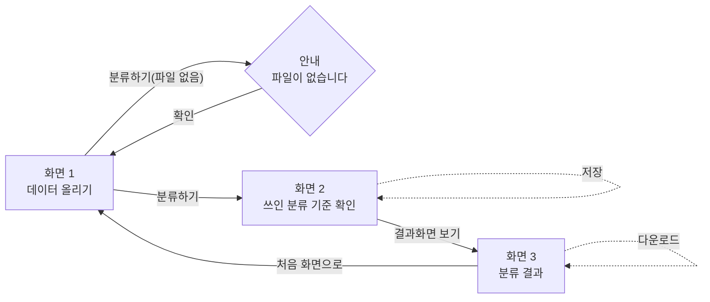

# 화면 흐름도

wireframe(Wireframes.png, "2 순서 수정 — 분류 기준 확인이 결과 앞으로") 기준. 화면 1의 게시물 URL 입력 칸은 wireframe.png("3 URL 입력 추가 — 화면 1에 게시물 URL 입력 칸 추가") 기준.

- 실선 화살표: 다른 화면(또는 안내)으로 이동하는 버튼
- 점선 화살표: 같은 화면에 머무르는 버튼(저장·다운로드) — 와이어프레임에 이동할 화면이 따로 표시되어 있지 않아, 제자리에 머무는 것으로 추정해 그렸음
- 입력을 잘못 넣었을 때(ipo.md "잘못 넣었을 때" 기준: 파일 없이 분류하기): 화면 1 → 안내("파일이 없습니다") → 다시 화면 1로 돌아옴. 안내만 보여주고 멈추지 않고 반드시 화면 1로 돌아가게 그렸음.
- 넣을 기능 1(scope.md, 분류 처리)에 게시물 URL이 합쳐져서, 화면 1은 표·글 파일뿐 아니라 게시물 URL도 입력받아 같은 흐름(S1 -- 분류하기 --> S2)으로 이어짐. URL 입력 칸은 wireframe.png 기준 파일 선택 칸 아래 "또는" 구분선 다음에 있음. 파일도 URL도 없을 때의 정확한 안내 문구는 아직 확인 필요(wireframe.png에는 자리만 표시).
- 넣을 기능을 3개 이하로 좁히면서 "잘못 나뉜 항목 옮기기"(항목 수정)는 빠짐. 화면 3의 소재 카드는 태그를 보여주기만 하고 고치는 기능은 없음(wireframe.png "4 기능 정리 — 화면 3 카드를 읽기 전용으로 변경" 기준). 화면 전환 흐름(S1→S2→S3) 자체는 바뀌지 않음.
